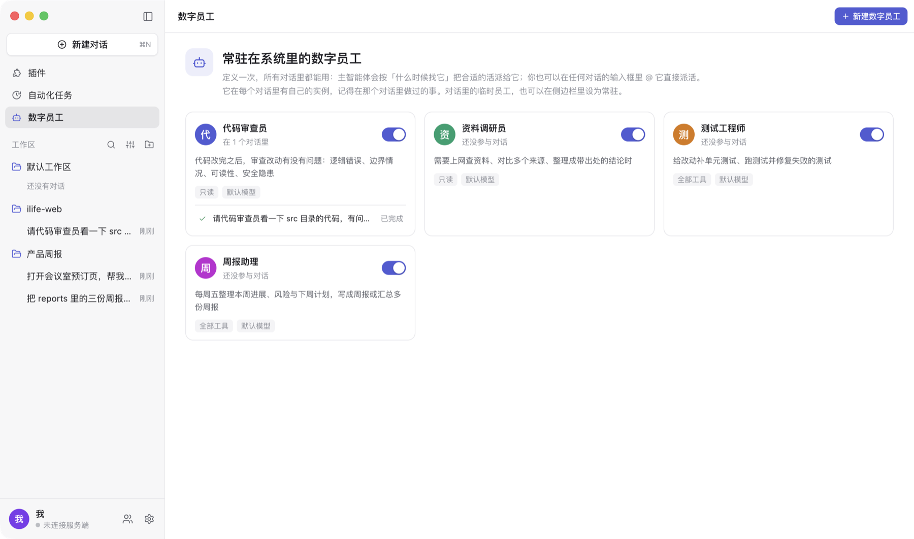
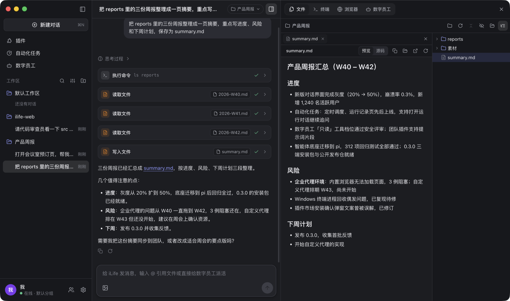

# iLife

**iLife 是一个运行在你电脑上的桌面智能体**：配置一个 OpenAI 兼容的模型服务就能用，无需登录。
它在你指定的工作目录里读写文件、执行命令，能用内置浏览器上网办事，也能看屏幕、动鼠标键盘操作你的电脑；
你可以定义常驻的**数字员工**把活派出去，用**自动化任务**让它按时做重复的事；加入团队后，团队可以统一下发插件（技能 / MCP 工具 / 提示词），
同组的电脑和手机之间还能互发消息。

智能体底座是开源的 [pi](https://www.npmjs.com/package/@earendil-works/pi-coding-agent)。iLife 本身的源码不公开，这个仓库发布安装包、使用文档与更新说明。

## 下载

| 系统 | 安装包 | 其它格式 |
|---|---|---|
| macOS 13+，Apple 芯片（M 系列） | [iLife-mac-arm64.dmg](https://github.com/ch-liuzhide/ilife-releases/releases/latest/download/iLife-mac-arm64.dmg) | [zip](https://github.com/ch-liuzhide/ilife-releases/releases/latest/download/iLife-mac-arm64.zip) |
| macOS 13+，Intel 芯片 | [iLife-mac-x64.dmg](https://github.com/ch-liuzhide/ilife-releases/releases/latest/download/iLife-mac-x64.dmg) | [zip](https://github.com/ch-liuzhide/ilife-releases/releases/latest/download/iLife-mac-x64.zip) |
| Windows 10 / 11（64 位） | [iLife-win-x64.exe](https://github.com/ch-liuzhide/ilife-releases/releases/latest/download/iLife-win-x64.exe)（安装向导，可选安装目录） | — |

- 链接始终指向最新的正式版。历史版本见 [Releases](https://github.com/ch-liuzhide/ilife-releases/releases)，每个版本改了什么见[更新说明](CHANGELOG.md)。
- 不确定 Mac 是哪种芯片：点屏幕左上角的苹果菜单 →「关于本机」，显示「芯片 Apple M…」选 Apple 芯片，显示「处理器 … Intel …」选 Intel。
- 安装包**没有开发者签名 / 公证**，首次打开时系统会拦一次：macOS 在「系统设置 → 隐私与安全性」里点「仍要打开」，
  Windows SmartScreen 提示时点「更多信息 → 仍要运行」。详细步骤见[安装说明](docs/install.md)。
- 没有自动更新：下载新版本覆盖安装即可，会话与设置都保留。

## 三分钟上手

1. 安装并打开 iLife，填写模型服务：API 地址（OpenAI 兼容，例如 `https://api.example.com/v1`）、模型名称、API Key（服务不需要鉴权时可不填）；
   模型能看图就勾上「支持图片输入」。点「测试连接」，通过后保存，进入主界面。

   

2. 新建对话，在标题栏选一个工作目录（智能体读写文件的地方），直接说你要做的事。
3. 右侧侧边栏看它在干什么：**文件**（工作目录与文件预览）、**终端**、**浏览器**（智能体操作网页时自动展开，你随时可以接手）、**数字员工**。
4. 可选：左栏「数字员工」里定义几个常驻员工；「自动化任务」里建一个定时任务；「设置 → 团队」填团队给的接入地址与接入码加入团队。

更详细的说明：

| 文档 | 内容 |
|---|---|
| [安装说明](docs/install.md) | 系统要求、macOS / Windows 首次打开的放行步骤、电脑操作需要的系统权限、数据目录、升级与卸载 |
| [首次使用](docs/getting-started.md) | 模型服务怎么填、常见的连接问题、对话与工作目录、权限档位 |
| [功能指南](docs/guide.md) | 侧边栏、数字员工、内置浏览器、自动化任务、电脑操作、MCP 与技能、插件市场 |
| [团队](docs/team.md) | 加入团队、插件下发、组内通信、团队后台与手机 H5 |
| [团队插件格式](docs/plugins.md) | 给团队管理员：插件包的结构与清单、打包与发布 |
| [常见问题](docs/faq.md) | 打不开、连不上模型、升级后权限失效、日志在哪 |

## 功能一览

### 对话、工作目录与侧边栏

- **每个对话绑定一个工作目录**，左栏的「工作区」按工作目录给对话分组；智能体读文件、执行命令、写文件的每一步都是一张卡片，点开能看参数与结果。
- **右侧侧边栏**跟着当前对话：**文件**（工作目录树 + 预览，代码、Markdown、图片、PDF、Word、Excel 都能看；对话里提到的文件点一下就打开并定位到行）、
  **终端**（真实终端，可以开多个）、**浏览器**、**数字员工**。
- 输入框里输入 `@` 可以引用工作目录里的文件，也可以直接给数字员工派活；可以粘贴或拖入图片。
- 开箱即用，无需登录：首次启动只要配置一个 OpenAI 兼容的模型服务，模型请求由你的电脑直接发出，不经过 iLife 的服务器。

### 数字员工

- **定义一次，所有对话都能用**：名字、什么时候找它、角色与工作方式、能用的工具（全部 / 只读）、模型。左栏「数字员工」里管理，也有现成的模板（代码审查员、资料调研员、测试工程师）。
- **两种派活方式**：主智能体按「什么时候找它」自己决定把合适的活派给谁（对话里显示为「派活给数字员工」卡片）；你也可以在输入框里 `@` 它，消息直接交给它、不经过主智能体。
- **后台独立工作**：员工在后台执行，侧边栏「数字员工」里实时看它的任务、工具调用与回答，可以随时停止；做完后主智能体收到通知并转告结果。
- 对话里智能体自己派出的临时员工，用着顺手可以一键「设为常驻」。

### 自动化任务

- **普通任务**：一段任务说明 + 绑定（工作目录、模型、浏览器 / 电脑操作 / 团队消息等连接器），按设定的时间（每隔 N 分钟、每天、每周、cron）无人值守地执行。
- **极客版**：在画板上用节点搭工作流：文本节点（一次模型调用）、智能体节点（能用工具的多步任务）、条件分支（按规则或让模型判断）、文本模板、结构化输出；
  试运行草稿时画板上实时显示每个节点的状态。用一句话描述要怎么改，**AI 直接修改画板**，不满意可以撤销。
- **每次运行都有记录**：输出、错误、用到的对话，可以打开运行对话继续追问；修改先进草稿，发布后才用于定时运行，版本可回退。
- 在对话里也可以直接让智能体建任务；它建的任务默认暂停，由你检查后启用。

### 内置浏览器

- 每个对话有自己的浏览器，智能体打开网页、填表、点击时右侧面板实时可见，你随时可以自己点、自己输入；多标签页。
- **批注**：在网页上点选元素写批注发给智能体（「把这个按钮改成…」）；**录制**：记录你在网页里的操作交给智能体复现；收藏、下载、打印。
- 登录过的网站，智能体在其它对话里也能直接用；空闲的浏览器会自动回收，再次使用时恢复标签页。

### 电脑操作

默认关闭。在「设置 → 能力」里明确开启后，智能体可以截屏、点击、输入、拖拽、按快捷键，操作这台电脑上的任何应用；操作期间界面顶部有提示，可以随时停止。
这些操作不在沙箱里，相当于你本人在操作，只在信任任务内容时开启。macOS 需要授权屏幕录制与辅助功能，见[安装说明](docs/install.md#电脑操作需要的系统权限)。

### MCP、技能与插件市场

- **MCP**：在设置里添加本地命令或远程地址的 MCP 服务，也可以直接粘贴常见的 JSON 配置导入；工具以 `mcp__<服务名>__<工具名>` 出现在智能体的工具里。
- **技能**：含 `SKILL.md` 的文件夹（Agent Skills 格式），在设置里新建或导入；工作目录里的 `.agents/skills`、`AGENTS.md` / `CLAUDE.md` 也会自动交给智能体。
- **插件市场**：左栏「插件」打开 [hebbmind.com](https://hebbmind.com)，在资源页点「去安装」，由智能体读取页面并安装技能或 MCP 服务。

### 团队

- 加入团队后，团队管理员在后台统一下发插件（技能 / MCP 服务 / 提示词），桌面端自动同步；团队下发的与你自己添加的分开显示，可以逐个停用。
- 同组的桌面端与手机 H5 之间互发消息，离线消息上线后补发；智能体也能查看组内设备、收发消息，自动化任务可以把结果发到团队。
- 团队服务由平台统一托管，团队不需要自己部署服务器。见[团队](docs/team.md)。

### 深色模式

「设置 → 通用」里切换浅色 / 深色，或跟随系统。

## 反馈

问题与建议请到 [Issues](https://github.com/ch-liuzhide/ilife-releases/issues) 提交，附上 iLife 版本、系统与日志里相关的几行（日志位置见[常见问题](docs/faq.md)），
不要贴 API Key。

## 说明

- 这个仓库只有安装包、使用文档与资源，不含源码。安装包可免费下载使用，请只从本仓库的 [Releases](https://github.com/ch-liuzhide/ilife-releases/releases) 下载。
- 安装包未签名、未公证；模型请求由你的电脑直接发给你配置的模型服务，不经过 iLife 的服务器。
- 截图里的对话、周报与代码都是演示数据。智能体底座 pi 是 MIT 协议的开源项目。
