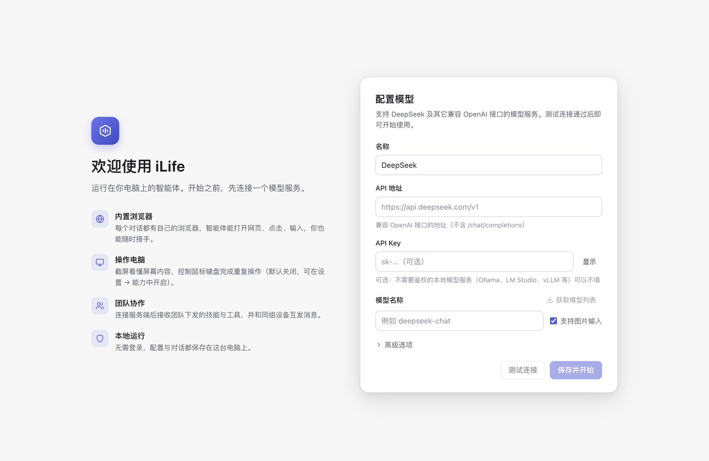
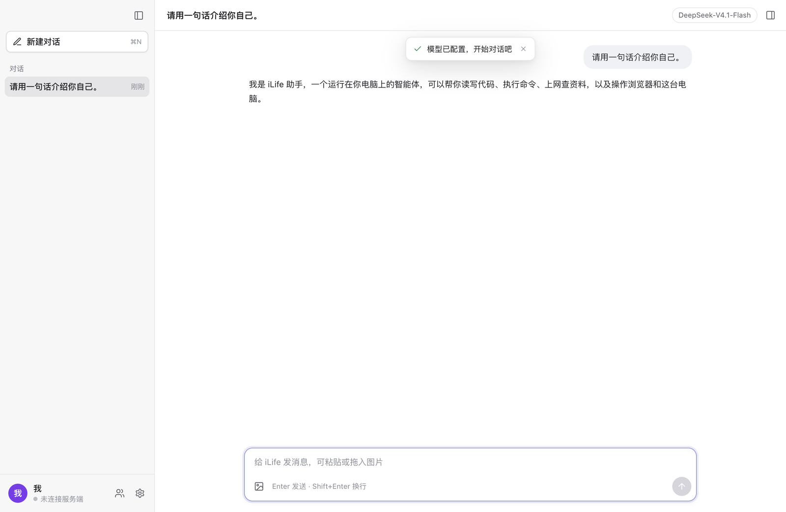
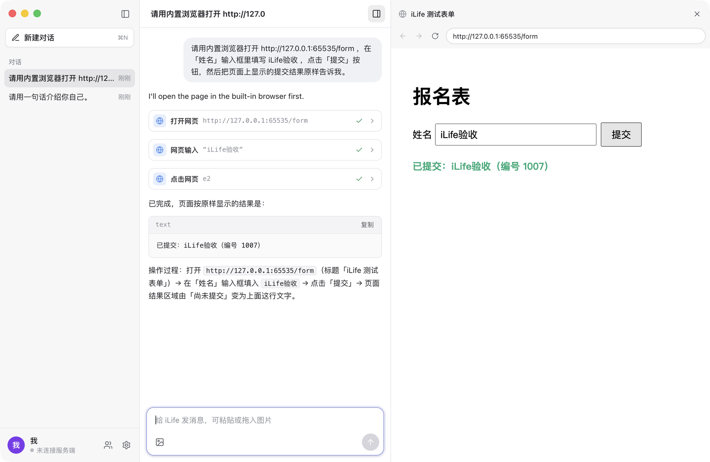
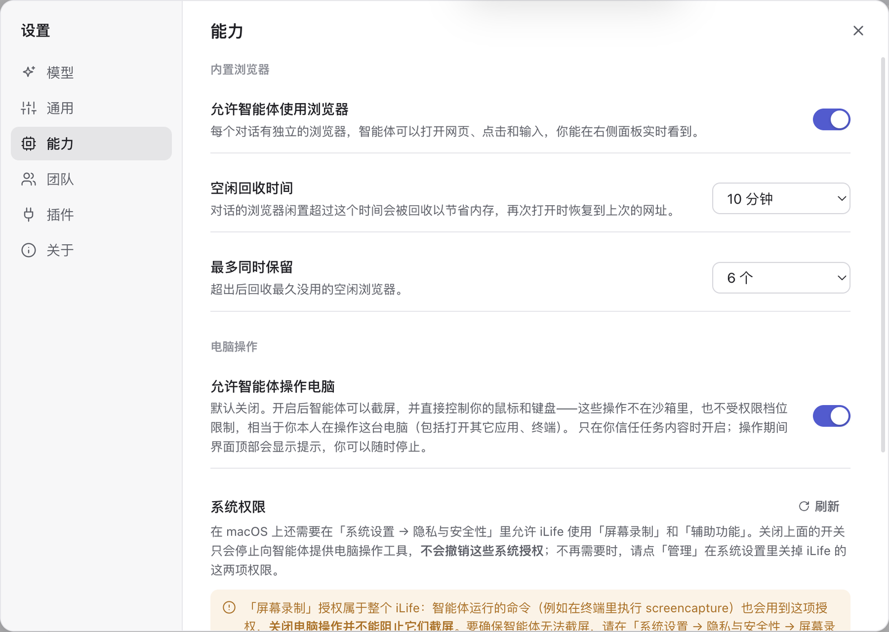

# iLife

**iLife 是一个桌面智能体客户端**：配置一个 OpenAI 兼容的模型服务就能用，无需登录。
它能用内置浏览器帮你上网办事（browser use），也能看屏幕、动鼠标键盘操作你的电脑（computer use）；
可以定义常驻的**数字员工**把活派出去，用**自动化任务**让它定时做事；加入团队后，团队可以统一下发插件（技能 / MCP 工具 / 提示词），
同组的电脑和手机之间还能互发消息。

智能体底座是开源的 [pi](https://www.npmjs.com/package/@earendil-works/pi-coding-agent)。iLife 本身的源码不公开，这个仓库发布安装包、使用文档与更新说明。

## 下载

| 系统 | 安装包 | 其它格式 |
|---|---|---|
| macOS 13+，Apple 芯片（M 系列） | [iLife-mac-arm64.dmg](https://github.com/ch-liuzhide/ilife-releases/releases/latest/download/iLife-mac-arm64.dmg) | [zip](https://github.com/ch-liuzhide/ilife-releases/releases/latest/download/iLife-mac-arm64.zip) |
| macOS 13+，Intel 芯片 | [iLife-mac-x64.dmg](https://github.com/ch-liuzhide/ilife-releases/releases/latest/download/iLife-mac-x64.dmg) | [zip](https://github.com/ch-liuzhide/ilife-releases/releases/latest/download/iLife-mac-x64.zip) |
| Windows 10 / 11（64 位） | [iLife-win-x64.exe](https://github.com/ch-liuzhide/ilife-releases/releases/latest/download/iLife-win-x64.exe)（安装向导，可选安装目录） | — |

- 链接始终指向最新的正式版。历史版本见 [Releases](https://github.com/ch-liuzhide/ilife-releases/releases)，每个版本改了什么见[更新说明](CHANGELOG.md)。
- 不确定 Mac 是哪种芯片：点屏幕左上角的苹果菜单 →「关于本机」，显示「芯片 Apple M…」选 Apple 芯片，显示「处理器 … Intel …」选 Intel。
- 安装包**没有开发者签名 / 公证**，首次打开时系统会拦一次：macOS 在「系统设置 → 隐私与安全性」里点「仍要打开」，
  Windows SmartScreen 提示时点「更多信息 → 仍要运行」。详细步骤见[安装说明](docs/install.md)。
- 没有自动更新：下载新版本覆盖安装即可，会话与设置都保留。

## 三分钟上手

1. 安装并打开 iLife，填写模型服务：API 地址（OpenAI 兼容，例如 `https://api.example.com/v1`）、模型 id、API Key（服务不需要鉴权时可不填）；
   模型能看图就打开「支持图片」。点「测试连接」，通过后保存，进入主界面。
2. 新建对话，在标题栏选一个工作目录（智能体读写文件的地方），直接说你要做的事。
3. 右侧侧边栏看它在干什么：**文件**（工作目录与文件预览）、**终端**、**浏览器**（智能体操作网页时自动展开，你随时可以接手）、**数字员工**。
4. 可选：「设置 → 能力」开启电脑操作；「设置 → 团队」填团队给的接入地址与接入码加入团队。

更详细的说明：

| 文档 | 内容 |
|---|---|
| [安装说明](docs/install.md) | 系统要求、macOS / Windows 首次打开的放行步骤、电脑操作需要的系统权限、数据目录、升级与卸载 |
| [首次使用](docs/getting-started.md) | 模型服务怎么填、常见的连接问题、对话与工作目录、权限档位 |
| [功能指南](docs/guide.md) | 侧边栏、数字员工、内置浏览器、自动化任务、电脑操作、MCP 与技能、插件市场 |
| [团队](docs/team.md) | 加入团队、插件下发、组内通信、团队后台与手机 H5 |
| [团队插件格式](docs/plugins.md) | 给团队管理员：插件包的结构与清单、打包与发布 |
| [常见问题](docs/faq.md) | 打不开、连不上模型、升级后权限失效、日志在哪 |

## 截图

截图来自较早的版本，界面细节与最新版可能略有不同。

**首次启动：直接配置模型**（无需登录；测试连接通过后才能进入对话）

**对话**：左侧是新建对话与会话列表，底部是用户信息、团队与设置

**内置浏览器**：每个会话绑定自己的浏览器，智能体填写表单、点击按钮时右侧面板实时可见

**设置 → 能力**：浏览器回收策略；电脑操作默认关闭，开启需要确认

**团队**：连接团队后，同组设备（这里是一台手机）互发消息

## 功能一览

- **开箱即用，无需登录**：首次启动只要配置一个 OpenAI 兼容的模型服务（地址 + 模型名，Key 按服务需要填写），测试通过即可开始对话。
- **会话 + 侧边栏**：左栏是新建对话、「插件」「自动化任务」「数字员工」入口和按工作区分组的对话；右侧是当前对话的侧边栏：
  文件（工作目录树 + 文件预览，对话里提到的文件点一下就能看）、终端（多个真实终端）、浏览器（多标签页，智能体操作时你实时看得到）、数字员工。
  每个对话绑定自己的工作目录，可以随时切换。
- **数字员工**：定义名字、什么时候找它、角色与工作方式、能用的工具（全部 / 只读）、模型，常驻在系统里。
  主智能体按「什么时候找它」把合适的活派给它，你也可以在输入框里 `@` 它直接派活；对话里还有智能体自己派出的临时员工，好用的可以设为常驻。
- **自动化任务**：普通任务（一段任务说明 + 工作目录、模型、连接器）或极客版（画板上的工作流：文本节点、智能体、条件分支、结构化输出），
  定时 / 重复运行，每次运行都有记录；AI 能按一句话描述改图。
- **内置浏览器**：多标签页、批注（在网页上点选元素写批注发给智能体）、录制（记录你的网页操作交给智能体复现）、收藏 / 下载 / 打印。
- **电脑操作**（默认关闭，在设置里明确开启）：截屏、点击、输入、拖拽、快捷键。
- **MCP 与技能**：在设置里添加 MCP 服务（本地命令或远程地址，可粘贴 JSON 导入）和技能（含 SKILL.md 的文件夹）；
  工作目录里的 `.agents/skills`、`.pi/skills` 与 `AGENTS.md` / `CLAUDE.md` 也会自动交给智能体。
- **插件市场**：左栏「插件」打开 [hebbmind.com](https://hebbmind.com)，在资源页点「去安装」，由智能体读取页面并安装。
- **团队**（可选）：团队统一下发插件（技能 / MCP / 提示词），同组的桌面端与手机 H5 互发消息，智能体也能收发组内消息。

## 反馈

问题与建议请到 [Issues](https://github.com/ch-liuzhide/ilife-releases/issues) 提交，附上 iLife 版本、系统与日志里相关的几行（日志位置见[常见问题](docs/faq.md)），
不要贴 API Key。

## 说明

- 这个仓库只有安装包、使用文档与资源，不含源码。安装包可免费下载使用，请只从本仓库的 [Releases](https://github.com/ch-liuzhide/ilife-releases/releases) 下载。
- 安装包未签名、未公证；模型请求由你的电脑直接发给你配置的模型服务，不经过 iLife 的服务器。
- 智能体底座 pi 是 MIT 协议的开源项目。
