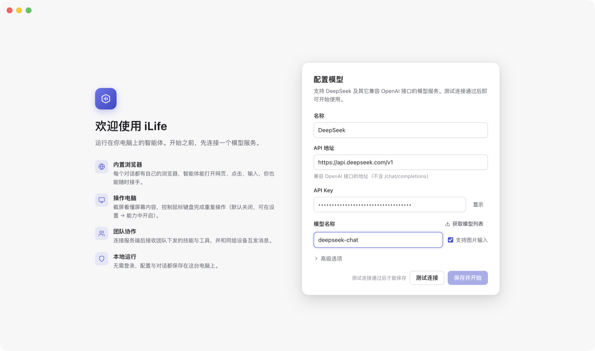
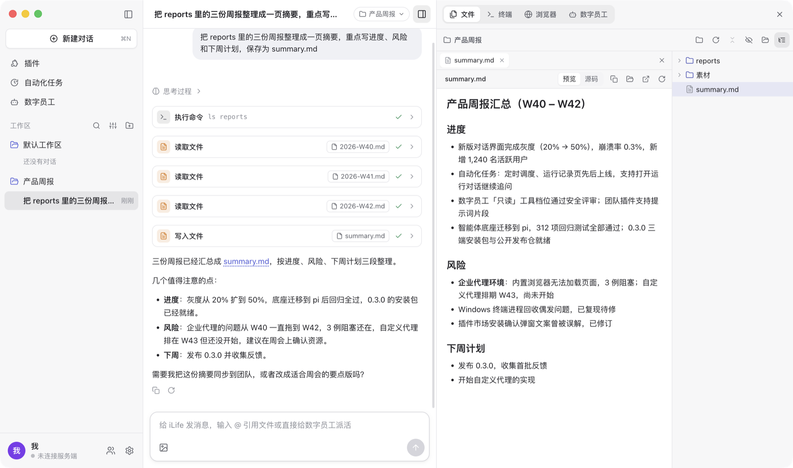

# 首次使用

## 1. 配置模型服务

打开 iLife 后先配置模型，测试连接通过才能进入对话。

- 支持任意 **OpenAI 兼容**（`/chat/completions`，流式 + 工具调用）的模型服务：填 API 地址（如 `https://api.example.com/v1`，末尾多写的 `/chat/completions` 会自动去掉）、
  模型 id，API Key 可选（本机或内网不需要鉴权的服务可以不填），可选自定义请求头；可配置多个服务和模型，选一个作为默认。
- **模型服务必须能从这台电脑直接访问**：模型请求由本机直接发出，不经过 iLife 的服务器。只在公司内网 / 办公网可用的地址，
  换到家庭或其它网络后就连不上，「测试连接」会失败，对话中会出现错误提示（例如 `Connection error`），换用当前网络可达的地址即可。
- **「支持图片」开关**：打开后截图（浏览器截图、电脑截屏）会作为图片送进模型；模型不支持图片时请关闭。关闭后智能体仍可通过页面快照（文本）使用浏览器，
  但电脑操作基本依赖看图，效果会很差。「测试连接」可以顺带发一张测试图片验证视觉能力。
- 智能体会调用工具（读写文件、执行命令、操作浏览器等），模型需要支持**工具调用**（function calling）；不支持的模型只能聊天。
- Key 只保存在本机的数据目录：Windows 用系统密钥（DPAPI）加密；macOS 以仅本人可读的文件权限保存，不使用钥匙串。Key 不会写进智能体的配置文件，智能体运行的命令也看不到它。

之后在「设置 → 模型」可以增删服务与模型、更换默认模型。

## 2. 新建对话与工作目录

- 左栏「新建对话」。每个对话绑定一个**工作目录**：智能体在这里读写文件、运行命令，侧边栏的文件树与终端也在这里。
  新建对话时在标题栏选择，之后也能随时切换（智能体或数字员工执行中除外）；切换后对话历史保留。默认工作目录是「文档/iLife」，可在设置里修改。
- 左栏的「工作区」按工作目录给对话分组：右上角可以搜索对话、排序 / 全部展开收起、添加工作区（选一个文件夹并在里面新建对话）。
- 输入框里输入 `@` 可以引用工作目录里的文件 / 文件夹（接着输入名字或路径的一部分实时筛选），也可以 `@` 数字员工直接派活。
- 对话里的「停止」只停智能体当前这一轮，不停后台的数字员工。

## 3. 侧边栏

对话标题栏右边的按钮打开 / 收起右侧侧边栏（可拖动调宽），快捷键 ⌘⇧E / ⌘J / ⌘⇧B（Windows 为 Ctrl）：

- **文件**：工作目录的文件树（目录变化自动刷新）+ 文件预览（代码高亮与行号、Markdown、图片、音视频、PDF、Word、Excel）。对话里提到的文件（如 `src/app.ts:12`）点一下就在这里打开并定位到行。
- **终端**：在工作目录里打开真实终端（macOS 为登录 shell，Windows 为 PowerShell），可以开多个、重命名。这是你自己的终端，不受智能体权限档位限制。
- **浏览器**：智能体用的浏览器，多标签页；它操作网页时侧边栏自动展开，你可以随时自己点、自己输入。
- **数字员工**：这个对话里的员工与它们的执行过程。

详见[功能指南](guide.md)。

## 4. 权限档位

「设置 → 通用」里的权限档位决定智能体能改哪些文件、运行的命令能做什么：

| 档位 | 文件 | 命令 | 电脑操作 |
|---|---|---|---|
| 只读 | 只能读文件、搜索 | 不能执行 | 停用 |
| 工作区可写（推荐，默认） | 只能写工作目录与临时目录里的文件（拒绝通过符号链接写到外面） | macOS 在系统沙箱里运行：工作目录以外只读，不能打开其他应用或用 AppleScript 控制它们；**Windows 没有沙箱**，权限与你在终端里一样 | 按「设置 → 能力」的开关 |
| 完全访问 | 不受限制，可以读写整台电脑上的文件 | 不受沙箱限制 | 按「设置 → 能力」的开关 |

- 侧边栏里你自己的终端不受档位限制。
- 电脑操作与内置浏览器不在沙箱里，相当于你本人在操作；只在信任任务内容时开启电脑操作或使用「完全访问」。

## 5. 可选：加入团队、开启电脑操作

- **加入团队**：「设置 → 团队」填团队管理员给的接入地址（如 `https://acme.teams.example.com`，没有域名时形如 `http://1.2.3.4:8787/t/acme`，整段照填）、
  接入码、设备名，保存即连接。连接后自动接收团队下发的插件，并可在左下角「团队」面板与同组设备收发消息。详见[团队](team.md)。
- **电脑操作**：「设置 → 能力 → 电脑操作」打开「允许智能体操作电脑」并确认；macOS 还要授权屏幕录制与辅助功能，见[安装说明](install.md#电脑操作需要的系统权限)。
