# 功能指南

- [侧边栏：文件、终端、浏览器、数字员工](#侧边栏文件终端浏览器数字员工)
- [数字员工](#数字员工)
- [内置浏览器（browser use）](#内置浏览器browser-use)
- [自动化任务](#自动化任务)
- [电脑操作（computer use）](#电脑操作computer-use)
- [MCP 与技能](#mcp-与技能)
- [插件市场](#插件市场)

## 侧边栏：文件、终端、浏览器、数字员工

右侧侧边栏（对话标题栏右边的按钮打开 / 收起，可拖动调宽）有文件、终端、浏览器（快捷键 ⌘⇧E / ⌘J / ⌘⇧B，Windows 为 Ctrl）和数字员工四个功能：

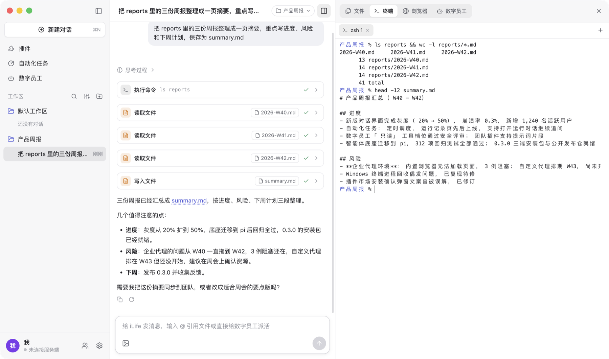

- **文件**：当前对话工作目录的文件树（目录变化自动刷新）+ 文件预览（代码高亮与行号、Markdown、图片、音视频、PDF、Word、Excel；其它格式显示系统缩略图，macOS 上可以快速查看）。
  对话里提到的文件（如 `src/app.ts:12`）点一下就在这里打开并定位到行。
  在输入框里输入 `@` 也能引用工作目录里的文件 / 文件夹：只输入 `@` 列出第一层，接着输入名字或路径的一部分实时筛选（不含 `.gitignore` 忽略的和 `node_modules` 这类目录），
  选中后插入 `@src/app.ts`，智能体按这个路径去读；发出去的消息里点它就能预览。
- **终端**：在对话的工作目录里打开真实终端（macOS 为登录 shell，Windows 为 PowerShell），可以开多个、重命名，切换对话或功能都不丢屏幕。
  这是你自己的终端，不受智能体权限档位限制。
- **浏览器**：见[内置浏览器](#内置浏览器browser-use)。
- **数字员工**：这个对话里的员工：常驻员工（带头像与「常驻」标记）和临时员工，执行中 / 已完成 / 未完成、耗时与用量，有员工在执行时标签上显示数量。
  点一个就能看它的执行过程（交给它的任务、思考、工具调用、回答，实时更新），执行中的可以停止（只停它这一轮，智能体会收到「已停止」的通知），也可以「全部停止」。
  对话里派出 / 派活给数字员工的卡片、员工的结束通知上都有「执行过程」按钮，一键打开这里。
  数字员工和智能体用同一个工作目录、权限档位和工具（包括内置浏览器；只读的员工不能改文件、执行命令、操作电脑，也拿不到 MCP 工具）；对话里的「停止」只停智能体这一轮，不停后台的员工。
  - **添加常驻员工**：选一个在左栏「数字员工」里定义好的员工加入这个对话，可以顺手写第一个任务；不写就先待命，之后 @ 它。
  - **新建临时员工**：填名称、角色与职责（可选）、第一个任务（可选，不填它先做个自我介绍），可以选择带上这个对话已有的内容。
  - **设为常驻**：在临时员工的执行过程里点「设为常驻」，确认名字、什么时候找它、角色等，它就成了常驻员工（这个对话里的它保留做过的事）。
  - **@ 派活**：在输入框里输入 `@`，从列表的「数字员工」一组里选（常驻的在前，下面一组是文件；也可以直接打出 `@名称`），写上要它做什么，发送。
    消息直接交给这个员工，不经过主智能体（它正在执行时排在当前这件事之后）；可以同时 @ 几个。常驻员工在这个对话里第一次被 @ 时才创建实例。
    它做完后主智能体会收到通知并转告结果。智能体派出的后台员工也能这样 @。
  - **删除 / 退出**：列表里悬停一行，临时员工点删除、常驻员工点退出这个对话（也可以在它的执行过程里操作），正在执行的会先停止；之后它不再接收消息、也不再出现在列表里
    （常驻员工本身还在，可以再加入）。
- **工作目录**：每个对话绑定一个工作目录，新建对话时可在标题栏选择，之后也能随时切换（智能体或数字员工执行中除外）；切换后对话历史保留，智能体之后的命令、文件树、
  新开的终端都在新目录里（已打开的终端留在原目录）。少数建不了目录链接的对话（例如 Windows 上的网络位置）不能切换，新建对话即可。左栏的「工作区」按工作目录给对话分组：
  右上角可以搜索对话、排序 / 全部展开收起、添加工作区（选一个文件夹并在里面新建对话），每个工作区悬停时也能直接在里面新建对话。

## 数字员工

点左栏的「数字员工」打开员工页面：右上角「新建数字员工」，或从模板开始（代码审查员、资料调研员、测试工程师）。

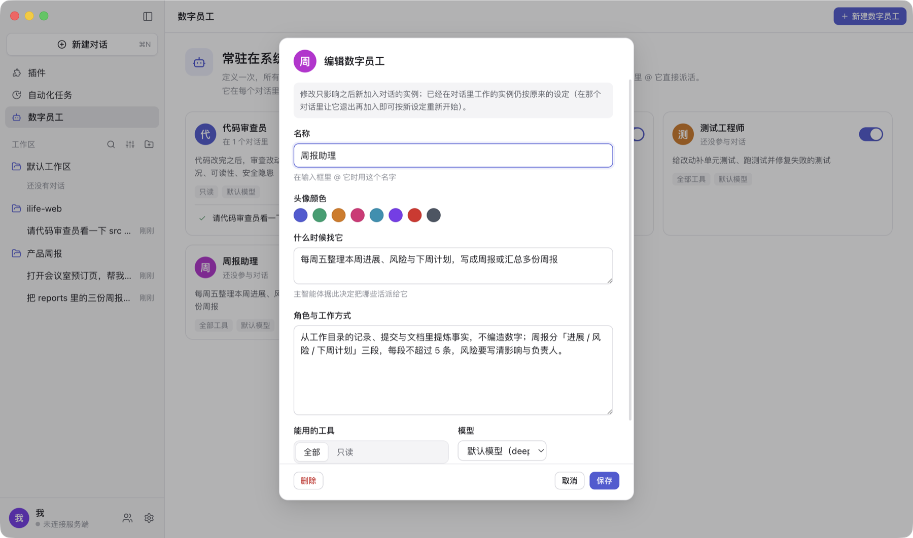

每个数字员工有：

- **名称**（@ 时用它）、**头像颜色**；
- **什么时候找它**：主智能体据此决定把哪些活派给它（聊天里显示为「派活给数字员工」卡片）；
- **角色与工作方式**：成为它的系统提示词；
- **能用的工具**：全部（与主智能体相同）或只读（不改文件、不执行命令、不操作电脑、不用 MCP 工具，可以读文件、上网、截图）；
- **模型**：不选就用默认模型。

卡片上能看到它正在哪些对话里工作（点一下切过去并在侧边栏打开它），可以随时停用（停用后主智能体看不到它、也不能 @ 它）、编辑或删除。
修改设定只影响之后新加入对话的实例；删除后，它在各对话里已有的实例留在原处、变成临时员工。

主智能体派活给它、它在侧边栏里执行的样子：

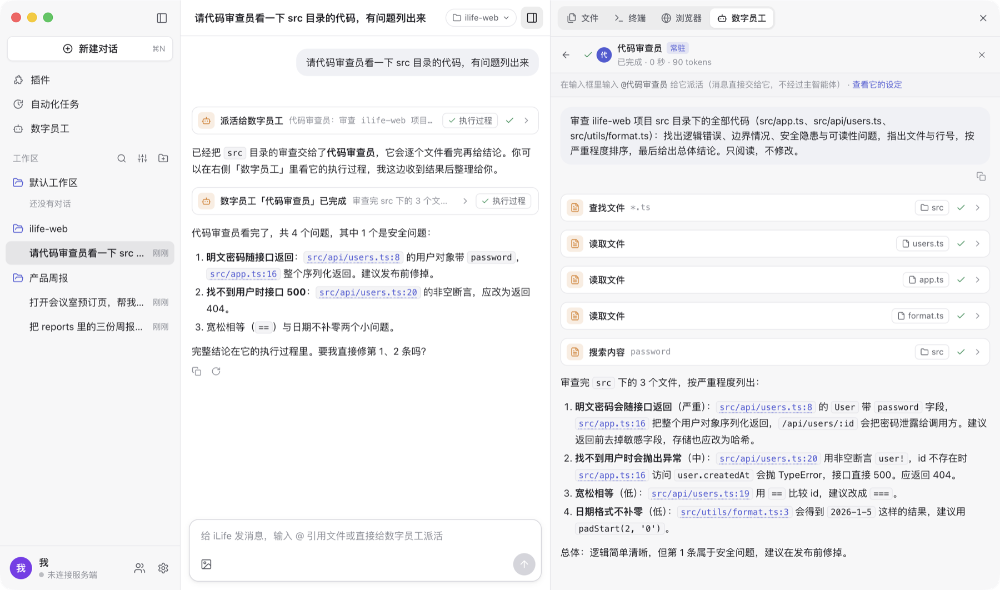

在输入框里输入 `@`，列表的「数字员工」一组里是常驻员工与这个对话里的临时员工，下面一组是工作目录里的文件：

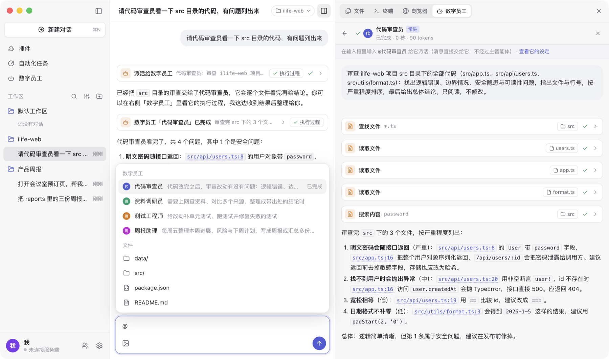

## 内置浏览器（browser use）

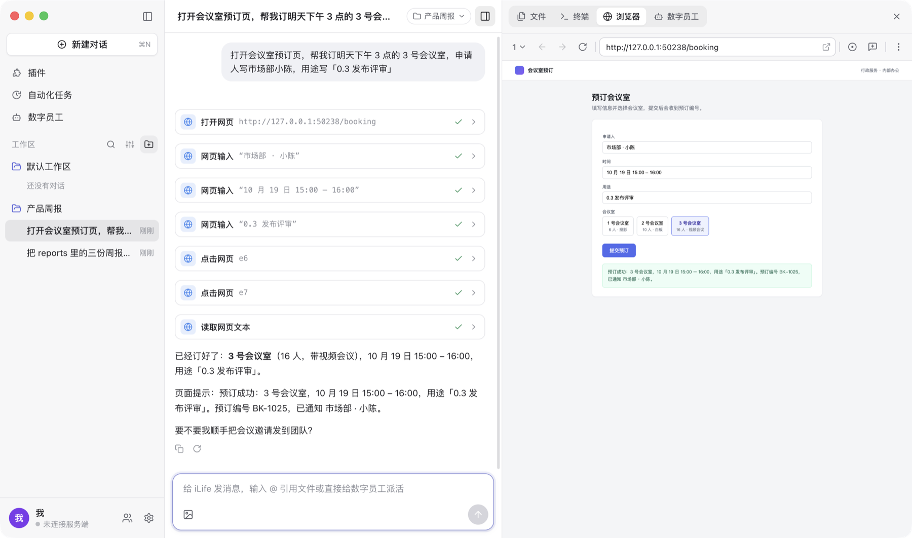

- 每个会话绑定一组浏览器标签页，显示在侧边栏的「浏览器」里；智能体使用浏览器时侧边栏自动展开，你可以随时自己点、自己输入。
- 多标签页：工具栏左侧的数字是标签页数，点开可切换 / 关闭 / 新建；网页里新窗口打开的页面（需要你刚点过或智能体正在操作）成为新标签页。
- 页面默认按桌面宽度排版、再按侧边栏宽度等比缩小显示（「⋮ → 关闭自动页面缩放」可关闭，⌘+ / ⌘- / ⌘0 调整）；⋮ 菜单里还有收藏此页、下载、打印、
  常驻收藏夹栏、清除浏览数据、开发者工具。你在面板里点的下载保存到系统「下载」目录；智能体操作触发的下载一律拒绝。
- **批注**（工具栏 💬+）：在网页上点选元素写批注，发消息时批注随消息一起发给智能体（「把这个按钮改成…」），也可以把带标记的页面截图加进输入框。
- **录制**（工具栏 ⊙）：录下你在网页里的点击、输入、滚动和跳转（密码不记录内容），停止后生成一份 Markdown 操作记录，可以复制、填进输入框或直接发给智能体复现。
- 所有会话共用一个持久化的浏览器分区：在面板里登录过的网站，智能体在其它会话里也能直接用。
- 智能体的浏览器工具：`browser_navigate` / `snapshot`（可交互元素列表）/ `click` / `type` / `press_key` / `scroll` / `screenshot` / `back` / `forward` /
  `get_text` / `wait` / `tabs`（列出 / 新建 / 切换 / 关闭标签页），都作用于当前标签页。点击和输入是真实输入事件。
- 空闲的会话浏览器会被回收（默认空闲 10 分钟回收、最多同时保留 6 个会话，「设置 → 能力」可改），下次使用时自动恢复标签页（只先打开当前标签页）；
  正在查看或正在执行任务的会话不回收。
- 内置浏览器可以在「设置 → 能力」里关闭（默认开启），关闭后智能体看不到浏览器工具。

## 自动化任务

点左栏的「自动化任务」打开自动化任务面板：右上角「新建任务」，在弹窗里先选普通任务或极客版、再填名称和分组（分组下拉里可以直接「新建分组」）；
列表按分组显示全部任务（可按形态筛选、搜索），每行能直接开关定时运行、立即运行，点进去是任务页（标题栏左侧可返回列表）。
自动化任务按设定的时间（手动、每隔 N 分钟、每天、每周、cron）无人值守地执行，每次运行都有记录（输出、错误、用到的对话，可以打开继续追问），
结束时可发系统通知（默认只在失败时）。

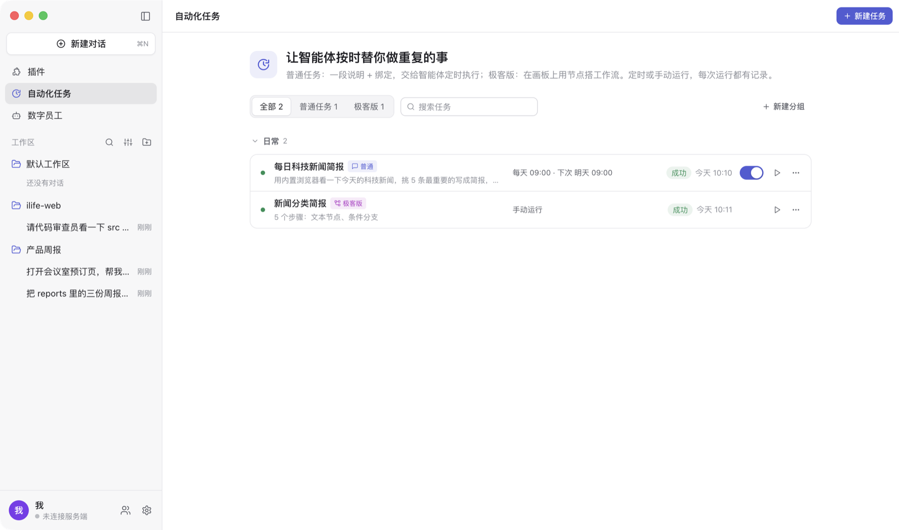

- **普通任务**：一段任务说明 + 绑定。绑定工作目录与模型；技能和 MCP 连接器写进任务说明作为指引；**内置连接器**（浏览器、电脑操作、团队消息）
  只有绑定了才能在无人值守运行中使用，没绑定的调用会被拒绝。
- **极客版**：画板上的工作流：开始、**文本节点**（一次模型调用：总结、分类、抽取、改写）、**智能体**（能用工具的多步任务）、**条件分支**
  （按字段规则或让模型判断）、文本模板、结束。提示词里用 `{{节点id.字段}}` 引用上游；节点可以要求模型输出**结构化数据**（字段与类型），
  每个节点还会自动拿到直接上游节点的输出（按连线给出）。可以试运行草稿，运行时画板上实时显示每个节点的状态。
- **版本**：修改先进草稿（画板自动保存），「发布」生成新版本，定时运行总是用最新发布的版本；版本列表里能看每次改了什么、恢复到任意版本。
- **AI 编辑**：在画板里用一句话描述要怎么改（「在摘要前加一个把新闻分成 科技 / 财经 / 其他 的节点，并按分类走不同分支」），改动进草稿，可撤销。
  在对话里也可以直接让智能体建或改自动化任务；智能体建的任务默认暂停、改动只进草稿，由你检查后启用 / 发布。

普通任务的运行记录（右上角是运行时机与启用开关，「打开对话」能看这次运行的完整过程）：

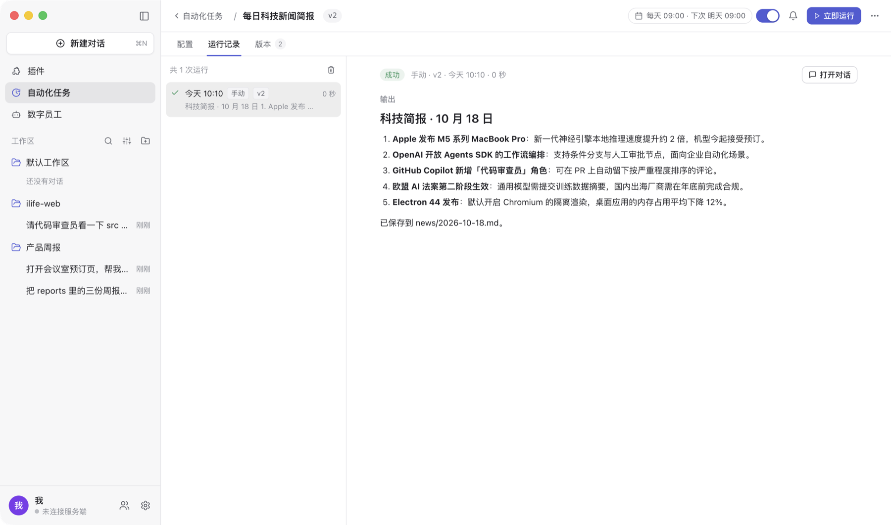

极客版：AI 编辑加上「分类」与「按分类分流」之后试运行，画板上每个节点显示运行状态：

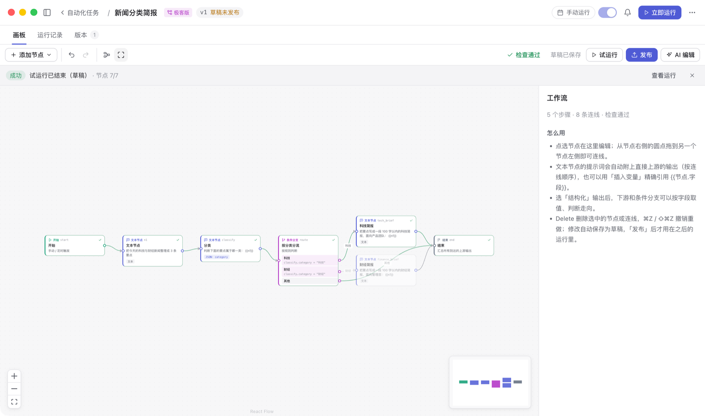

## 电脑操作（computer use）

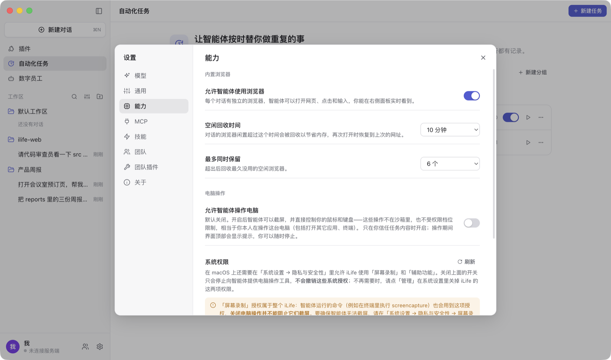

- **默认关闭**。在「设置 → 能力 → 电脑操作」打开「允许智能体操作电脑」并在确认框里确认后，智能体才有电脑操作工具（智能体在空闲时自动重启以更新工具）。
  这些操作不在沙箱里、不受权限档位限制，相当于你本人在操作这台电脑，只在信任任务内容时开启。权限档位为「只读」时电脑操作始终停用。
- 工具：`computer_screenshot` / `click` / `move` / `drag` / `scroll` / `type` / `key` / `wait`，坐标以最近一次截图为准（自动处理 Retina / 缩放）。
  智能体操作电脑时界面会显示「智能体正在操作电脑」提示条，可以随时停止这一轮任务。
- **macOS 需要授权**屏幕录制与辅助功能，首次操作时系统还会询问是否允许控制「System Events」；升级新版本后需要重新授权。步骤见[安装说明](install.md#电脑操作需要的系统权限)。
- Windows 不需要额外授权；但普通权限运行的 iLife 无法操作「以管理员身份运行」的窗口（系统限制）。

## MCP 与技能

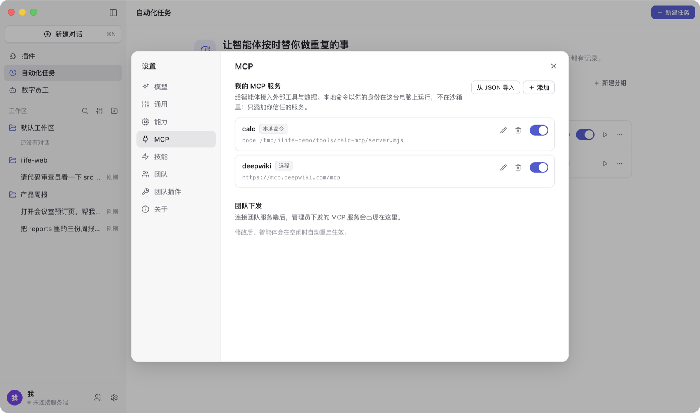

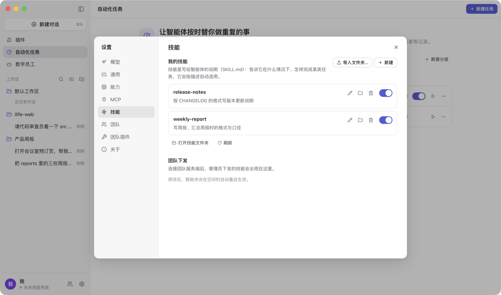

- **MCP 服务**：「设置 → MCP」添加本地命令（stdio）或远程地址（Streamable HTTP）的 MCP 服务，可以直接粘贴常见的 JSON 配置导入；工具以 `mcp__<服务名>__<工具名>` 出现在智能体的工具里。
- **技能**：「设置 → 技能」新建或导入含 `SKILL.md` 的文件夹（Agent Skills 格式：YAML 前言里有 `name` 与 `description`）。
- 工作目录里的 `.agents/skills`、`.pi/skills` 与 `AGENTS.md` / `CLAUDE.md` 会自动交给智能体，不用在设置里添加。
- 团队下发的 MCP 服务与技能和自己添加的分开显示，团队的只能停用、不能编辑；见[团队](team.md)。
- 改动在智能体空闲时生效（它会自动重启以更新工具）。

## 插件市场

左栏「插件」打开 [hebbmind.com](https://hebbmind.com)。在资源页点「去安装」，iLife 新建一个对话，智能体读取资源页面并安装：
技能与 MCP 服务装进 iLife 前会弹窗确认（「去安装」新建的那个对话里，装你点的那一个不再确认）；已安装的在页头「已安装」里。

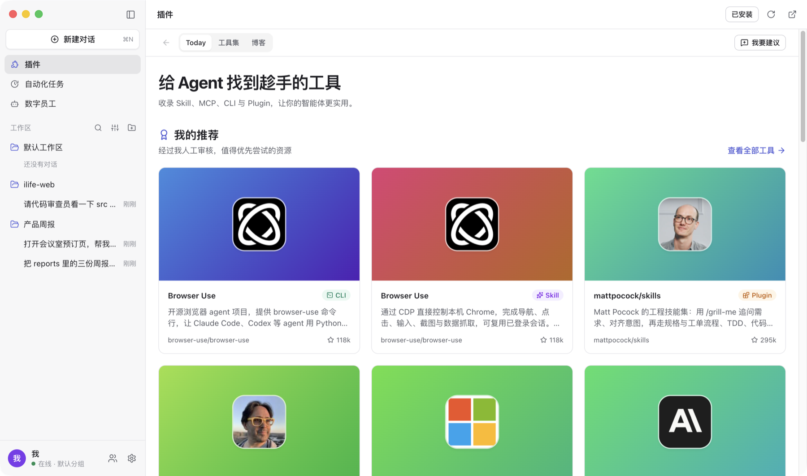
