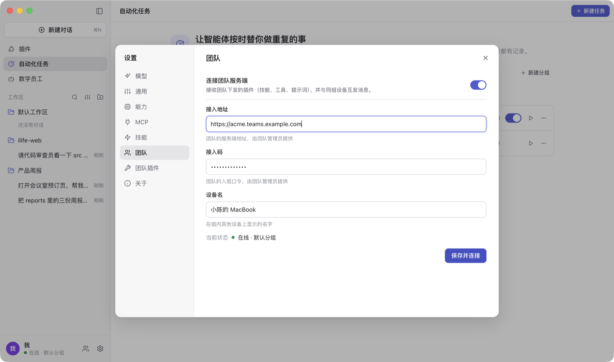
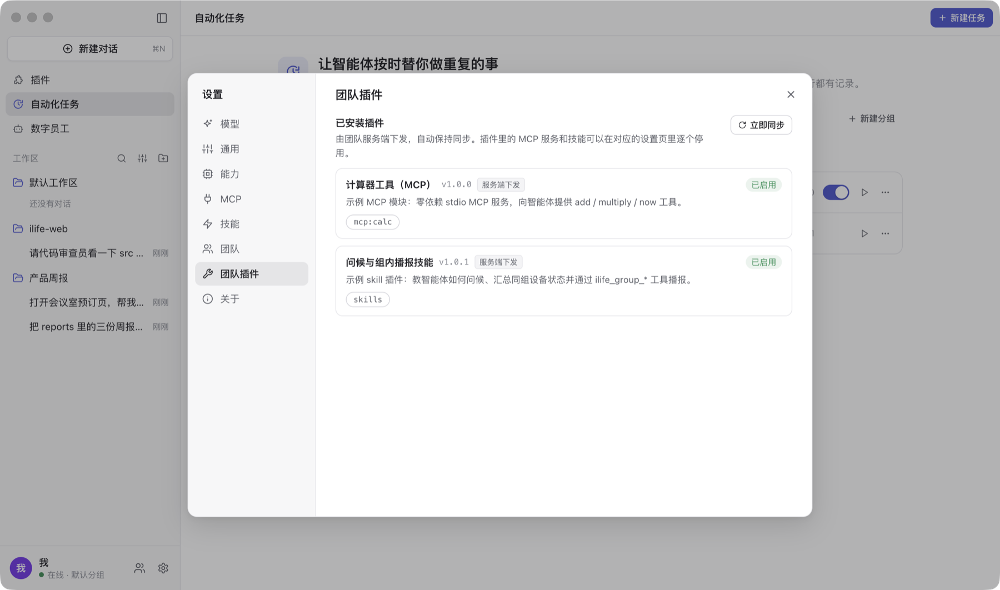

# 团队

iLife 单机就能用。加入团队后，团队可以统一下发插件（技能 / MCP 服务 / 提示词），同组的桌面端与手机 H5 之间可以互发消息，智能体也能收发组内消息。
团队服务由平台统一托管，团队不需要自己部署服务器。

## 加入团队

团队创建后拿到两样东西，由团队管理员发给成员：

| 项 | 形式 | 说明 |
|---|---|---|
| 接入地址 | 有域名：`https://acme.teams.example.com`；没有域名：`http://1.2.3.4:8787/t/acme` | 桌面端、手机 H5、团队后台都用它，**整段照填**，不要自己去掉 `/t/acme` |
| 接入码 | 一串随机字符 | 团队默认分组的入组口令；团队管理员可在团队后台「分组」页轮换 |

- **桌面端**：「设置 → 团队」填接入地址、接入码、设备名，保存即连接。
- **手机**：用相机扫团队后台「分组」页的二维码，或打开 `<接入地址>/m/` 手输接入码。
- 接入地址填错（指向别的网站、团队不存在）或团队已停用时，设置页直接提示「接入地址无效或团队不存在」/「团队已停用」，不会反复重试；改对地址或联系管理员后重新保存。
- 团队被停用后所有连接立即断开，恢复后自动重连。

## 插件下发

- 团队管理员在团队后台上传插件包、设置版本状态（本地 / 预发 / 正式）、上线下线、限定分组与客户端版本；每台设备只会拿到自己渠道可见的最高版本。
- 桌面端在启动时、收到服务端通知时、以及每 5 分钟同步一次：下载 → 校验 → 解压到数据目录 → 智能体空闲时重启生效。服务端不再下发的插件自动卸载，紧急下线的插件立即停用。
- 桌面端支持三类插件内容：**技能**、**MCP 服务**（本地命令）、**提示词**；其它类型显示为「本客户端不支持」，不会执行。
- 团队下发的 MCP 服务、技能在「设置 → MCP / 技能」里与你自己添加的分开显示，可以逐个停用（不能编辑）。
- 插件只在**服务端连接开启**时生效：在「设置 → 团队」关闭连接后，已安装的插件保留在本机但全部停用，重新开启后恢复；
  服务端只是暂时连不上时，已安装的插件照常生效，恢复连接后再同步。
- **换接入地址（换团队）后，上一个团队下发的插件立即全部停用**（「设置 → 团队插件」里标为停用并说明原因），与新团队同步成功后按新团队的列表重装 / 卸载；改回原地址则立即恢复。
- **明文地址的限制**：接入地址既不是 `https://` 也不是本机（`localhost` / `127.x.x.x`）时，插件包以明文传输、可能被同一网络里的人替换，
  所以 iLife 只启用插件里的技能，**MCP 服务和提示词默认停用**（「设置 → 团队插件」里标为「需要 HTTPS」）。确实只能用明文地址（例如可信的内网）时，
  可以在「设置 → 团队」打开「允许明文服务端下发可执行插件」（需要确认，默认关闭）。
- 已安装的团队插件与每项内容是否生效，都在「设置 → 团队插件」里查看。

## 组内通信

- 分组是通信边界：设备凭接入码加入分组，同组的桌面端与手机 H5 之间可以互发消息（全部 / 指定设备），离线消息上线后补发。
- 桌面端左下角的「团队」面板：组内设备列表、消息流、发送。
- 智能体也能查看组内设备、收发消息（例如「把这份总结发给组里所有人」）。自动化任务里要用团队消息，需要在任务里绑定「团队消息」连接器。

## 团队管理员：团队后台

- 地址 `<接入地址>/admin/`（例如 `https://acme.teams.example.com/admin/` 或 `http://1.2.3.4:8787/t/acme/admin/`），账号 `admin`，密码由平台创建团队时给出（只显示一次，忘记了请平台重置）。
  「修改密码」在后台右上角用户菜单。
- **分组**：查看分组与入组口令、轮换接入码、展示手机入组二维码。
- **设备**：已加入的桌面端与手机，在线状态、客户端版本；可以下发设备渠道（正式 / 预发 / 本地，决定能看到哪些状态的插件版本）。
- **模块**：上传插件包、版本状态流转、上线 / 下线、绑定客户端版本范围、限定分组、可见性预览、发布进度（每台设备是否装上应得的版本）、紧急下线。
  插件包的格式见[团队插件格式](plugins.md)。
- **配置**：团队全局的默认配置，以及给支持配置的插件按 团队 / 分组 / 设备 三层下发配置。
- **审计**：后台操作记录。
